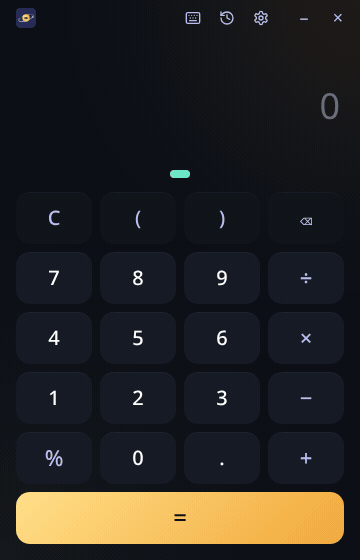
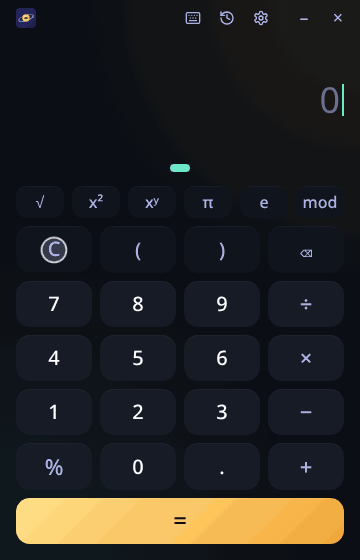
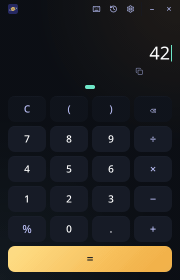
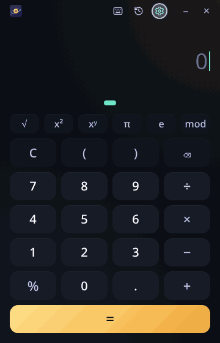

  

<h1 align="center">Orbit</h1>

  
  
  
  
  
  
  

## What is Orbit?

Orbit is a desktop calculator with sessions you slide between. Its purpose: calculate without losing your previous calculations.

**The problem:** Most calculators show one calculation at a time. When you start a new one, the old answer is gone, so you have to write it down or work it out again.

**How Orbit helps:** Orbit keeps several calculations open at once, each in its own session (like pages). For example, session 1 for your shopping total and session 2 for splitting a bill. Swipe, or press Ctrl+1 and Ctrl+2, to move between them. Every session keeps its numbers and history, even after you close Orbit.

## See it in action

<table>
  <tr>
    <td align="center"> <b>Calculate</b> The result shows as you type</td>
    <td align="center"> <b>Sessions</b> Ctrl+T for a new one, Ctrl+1–9 to switch</td>
  </tr>
  <tr>
    <td align="center"> <b>History and copy</b> Bring back a calculation, copy the result</td>
    <td align="center"> <b>Settings</b> Theme, decimals, dots or numbers</td>
  </tr>
</table>

https://github.com/user-attachments/assets/cadc3f83-1f6b-4b0a-ae49-05adb91112fa

## Limitations

- **Basic math only:** `+ − × ÷ %` and brackets. No powers, roots, sin/cos/log, constants like π, or memory keys yet.
- **Up to 9 sessions**, one per Ctrl+1…9. Each keeps its newest 200 calculations in history.
- **Results show up to 15 digits.** With fixed decimals (Settings), results are rounded, and the rounded value is what you go on with: `1 ÷ 3` with 4 decimals, times 3, gives `0.9999`.
- **Saved on this computer only:** sessions and settings stay in the app, with no sync between devices.
- **x64 builds for Linux and Windows:** no ARM versions yet (macOS covers Apple Silicon and Intel).
- **Not signed yet:** Windows shows "More info → Run anyway", and on macOS right-click Orbit → Open the first time.
