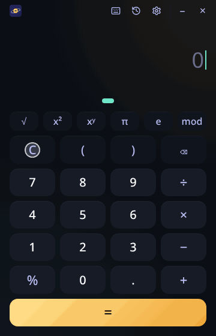
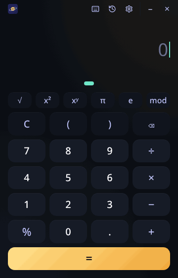

  

<h1 align="center">Orbit</h1>

  
  
  
  
  
  
  

Orbit is a desktop calculator with sessions you slide between, so you never lose a previous calculation. Keep your shopping total in session 1 and a bill split in session 2; each keeps its numbers and history, even after you close Orbit.

   
  <b>Sessions</b>: Ctrl+T for a new one, Ctrl+1–9 or a swipe to switch

<table>
  <tr>
    <td align="center"> <b>Edit anywhere</b> Click in the line or use ← →</td>
    <td align="center"> <b>√ x² xʸ π e mod</b> Next to the basic keys</td>
  </tr>
  <tr>
    <td align="center"> <b>History and copy</b> Bring back a calculation</td>
    <td align="center"> <b>Settings</b> Theme, decimals, dots or numbers</td>
  </tr>
</table>
